# Shah Latif Dairy Hyderabad — Complete Technical & Functional Documentation

> **Brand:** Shah Latif Dairy Hyderabad (شاہ لطیف ڈیری حیدرآباد)  
> **Physical Location:** Main Road, Latifabad Unit 7, Hyderabad, Sindh, Pakistan  
> **Direct Contact / WhatsApp:** +92 346 3822668  
> **Verified Social Proof:** 4.1★ Rating (1,449+ verified local reviews on Google Maps)  
> **Development Server:** `http://localhost:5174/`

---

## 1. Executive Summary & Core Architecture

This web application is a bespoke, high-performance solution engineered for **Shah Latif Dairy Hyderabad**—a renowned heritage dairy brand in Latifabad known for traditional Lachha Rabri, grass-fed buffalo milk, and pure Bilona Desi Ghee.

The application uses a **Dual-Mode Application Architecture** that unifies customer e-commerce with in-store counter operations:

1. **Customer Storefront Mode:** A high-converting, mobile-first e-commerce landing page designed for local Hyderabad patrons to explore dairy products, select custom weights/portions, and place orders directly through WhatsApp or store pickup.
2. **Internal Cashier POS Mode:** A rapid touch/keyboard terminal designed for counter staff handling high-volume walk-ins, phone calls, and dispatch orders.

```mermaid
graph TD
    App["Shah Latif Dairy Web Application"] --> Storefront["1. Customer Storefront Mode"]
    App --> POS["2. Internal Counter POS Mode"]

    subgraph StorefrontMode["Customer Storefront"]
        Storefront --> Hero["Hero & Social Proof (4.1★, 1,449+ Reviews)"]
        Storefront --> Trust["Trust & Credibility Bar"]
        Storefront --> Catalog["Searchable & Filterable Catalog"]
        Storefront --> Portions["Dynamic Portion & Price Calculator"]
        Storefront --> Cart["Interactive Slide-Over Cart Drawer"]
        Storefront --> WhatsApp["Pre-formatted WhatsApp Checkout Engine"]
        Storefront --> Heritage["Heritage & Purity Story"]
        Storefront --> Reviews["Verified Local Customer Reviews"]
    end

    subgraph POSMode["Internal Staff POS Terminal"]
        POS --> FastPicks["1-Tap High-Volume Fast Picks Grid"]
        POS --> ScaleTool["Custom Loose Weigher & Scale Tool"]
        POS --> LiveBill["Active Order Summary & Receipt Builder"]
        POS --> Tenders["Cash Tendered & Change Return Calculator"]
        POS --> ThermalSlip["80mm Printable Thermal Receipt Slip"]
        POS --> ShiftTally["Shift Transaction History & Revenue Metrics"]
    end
```



---

## 2. Global Header & Navigation Controls

The persistent header at the top of the interface provides essential customer information and immediate mode toggling.

### 2.1 Announcement Bar
- **Fresh Batch Indicator:** An active green pulsing badge confirming that morning and evening iron-kadhai batches of Rabri and Milk are currently available at the Latifabad Unit 7 counter.
- **Location Tag:** Displays `"Main Road, Latifabad Unit 7, Hyderabad"`.
- **4.1★ Rating Score:** Summarizes verified Google Reviews (1,449+ local reviews).
- **Store Hours & Phone CTA:** Lists operating hours (`6:00 AM – 11:30 PM Daily`) with a clickable phone link to `tel:+923463822668`.

### 2.2 Brand Insignia & Dual-Mode Switcher
- **Logo Badge:** Traditional Sindhi calligraphy insignia featuring the letter **"ش"** (Sheen) inside a gold-accented espresso badge.
- **Desktop Mode Switcher Pill:**
  - `[ 🛍️ Customer Store ]`: Displays the public e-commerce storefront.
  - `[ ⚡ Staff POS Mode ]`: Switches to the cashier counter terminal.
- **Mobile Mode Switcher Button:** An instant `[POS]` / `[Store]` pill visible directly on the mobile navigation bar for single-tap switching on smartphones and tablets.
- **Live Cart Trigger Pill:** Displays the live item badge count and dynamic subtotal (e.g., `Cart • Rs. 1,100`).

---

## 3. Component 1: Customer Storefront (Landing Page)

### 3.1 Hero Section
- **Appetizing Headline:** *"Hyderabad’s Pride for Pure Dairy & Lachha Rabri"* with traditional Urdu subtitle *"روایتی ذائقہ، خالص پن اور دہائیوں کا اعتماد"*.
- **Verified Local Social Proof:** Prominent rating badge showing 4.1★ across 1,449+ local reviews and Latifabad Unit 7 location pin.
- **Dual Conversion CTAs:**
  1. **"Order via WhatsApp":** Direct one-click link to WhatsApp chat (`https://wa.me/923463822668`) with a pre-filled greeting.
  2. **"Browse Fresh Menu":** Triggers smooth scrolling to the product menu.
- **Culinary Visual Showcase Card:** High-resolution presentation of handcrafted Lachha Rabri in clay matkas, with real-time base rates for Buffalo Milk (Rs. 240/L), Desi Ghee (Rs. 2,600/KG), and Pista Kulfi (Rs. 120/piece).
- **Floating Guarantee Widgets:**
  - *"100% Purity Guarantee — Open counter Lactometer testing welcome"*
  - *"Latifabad Counter — Open for Walk-ins & Delivery"*

### 3.2 Trust & Credibility Bar
Four key credibility indicators highlighting local authority:
1. **4.1★ Verified Rating:** Trusted by 1,449+ Hyderabad families.
2. **100% Danedar Desi Ghee:** Cultured Bilona churning with zero palm oil or synthetic essence.
3. **Farm-Fresh Twice Daily:** Milking dispatch at 6:00 AM and fresh kadhai Rabri at 5:00 PM.
4. **Latifabad Cold Delivery:** Motorcycle insulated bags ensuring deliveries within 45 minutes across Hyderabad.

### 3.3 Filterable & Searchable Product Catalog
- **Category Filter Tabs:**
  - *All Products*
  - *Fresh Milk (خالص دودھ)*
  - *Lachha Rabri (لچھا ربڑی)*
  - *Desi Ghee & Butter (دیسی گھی و مکھن)*
  - *Fresh Dahi / Yogurt (تازہ دہی)*
  - *Traditional Kulfi (روایتی قلفی)*
- **Live Search Field:** Real-time multi-lingual search matching English and Urdu keywords (e.g., "rabri", "ghee", "doodh", "makhan").
- **Sorting Options:** Sort by popularity/bestseller, price low-to-high, and price high-to-low.

### 3.4 Product Card Anatomy & Dynamic Portion Selector
Every product card provides granular portion selection:
- **Portion Selection Grid:**
  - *Lachha Rabri:* 250g (Pao), 500g (Half KG Dabba), 1 KG (Box), and 2 KG (Clay Matka).
  - *Buffalo Whole Milk:* 1 Liter, 2 Liters, 5 Liter Can, and 10 Liter Family Pack.
  - *Desi Ghee:* 500g Jar, 1 KG Tin, 2 KG Tin, and 5 KG Catering Tin.
  - *Fresh Dahi:* 500g, 1 KG Tub, 1 KG Clay Kunri Handi, and 5 KG Bucket.
  - *Khoya Pista Kulfi:* 1 Single Stick, Box of 6 Sticks, Clay Matka Kulfi, and Party Pack of 12.
- **Dynamic Pricing:** Selecting a portion immediately recalculates the card price and total cost.
- **Quantity Stepper (+/-):** Allows customers to add multiple packs easily.
- **"Add to Cart" Action:** Pushes the item with the exact portion label into the global cart and displays an animated toast notification.
- **"Quick WhatsApp Order" Badge:** Enables single-click purchasing of that specific item directly through WhatsApp without navigating through the cart.

### 3.5 Heritage & Purity Process Section
Details the artisanal process behind Shah Latif Dairy:
- **01. Indus River Plain Buffaloes:** Sourced from ethical grass-fed herds yielding 7.2%+ natural butterfat.
- **02. Heavy Iron Kadhais:** 4+ hours of low-heat simmering; clotted malai ribbons hand-scraped layer by layer.
- **03. Terracotta Clay Pot Fermentation:** Porous earthen clay kunris absorb excess whey, yielding dense, spoonable yogurt.
- **04. Ancient Bilona Method:** Cultured curd churned into white butter, then slow-clarified into golden aromatic granules (danedar).

### 3.6 Verified Local Reviews Section
Authentic customer testimonials from Hyderabad neighborhoods:
- Engr. Tariq Mehmood Memon (Latifabad Unit 6)
- Dr. Farzana Shaikh (Qasimabad Phase 2)
- Haji Abdul Rehman Ansari (Latifabad Unit 7)
- Kashif Ali Mughal (Auto Bhan Road)
- **Catering Callout Banner:** Dedicated contact prompt for weddings, majalis, and bulk Rabri matka catering.

### 3.7 Slide-Over Interactive Cart Drawer
Clicking the cart pill opens a slide-over panel:
- **Free Delivery Milestone Bar:** Tracks progress toward free delivery in Hyderabad (unlocked on orders over Rs. 1,500).
- **Line Items List:** Displays item thumbnail, name, chosen portion, unit price, quantity steppers, and a remove button.
- **Fulfillment Method Toggle:** Switch between **Home Delivery** and **Store Pickup (Latifabad Unit 7)**.
- **Hyderabad Area Selector:** Dropdown covering Latifabad (Units 1–12), Qasimabad, Saddar, Auto Bhan, Citizen Colony, Hirabad, and Gul Centre.
- **Customer Information Fields:** Name, contact phone, street address, and delivery notes (e.g., "Deliver before 8:00 AM").
- **Financial Breakdown:** Subtotal, delivery fee, and net grand total.
- **"Checkout via WhatsApp" Engine:** Formats a structured WhatsApp message with full details and opens `https://wa.me/923463822668?text=...` in a new tab for counter confirmation.

### 3.8 Storefront Footer
- Full address: Main Road, Latifabad Unit 7, Hyderabad, Sindh.
- Direct phone (+92 346 3822668) and WhatsApp channels.
- Daily operating hours (6:00 AM – 11:30 PM).
- Quick launch button for internal staff to switch to POS mode.

---

## 4. Component 2: Multi-Item POS System (Internal Staff View)

Designed specifically for counter staff on desktop monitors, touch screens, and tablets in the physical shop.

### 4.1 Cashier Terminal Status Bar
- Terminal identifier: `Counter #01 (Latifabad Main Branch) • ONLINE`.
- Real-time digital clock with auto-updating seconds.
- Held orders indicator with one-click restore.
- Shift sales summary trigger button.

### 4.2 Left Column: Product Selection Station
1. **Counter Fast-Picks Grid (1-Tap Buttons):**
   - High-volume items are accessible with single-tap buttons for rapid counter order entry:
     - *1L Milk* (Rs. 240)
     - *2L Milk* (Rs. 480)
     - *5L Milk Can* (Rs. 1,150)
     - *Rabri 250g Pao* (Rs. 280)
     - *Rabri 500g Dabba* (Rs. 550)
     - *Rabri 1 KG Box* (Rs. 1,100)
     - *Desi Ghee 1 KG* (Rs. 2,600)
     - *Sada Dahi 1 KG* (Rs. 320)
     - *Sada Dahi 500g* (Rs. 160)
     - *Pista Kulfi* (Rs. 120)
     - *Kulfi Box 6 Pcs* (Rs. 680)

2. **Custom Loose Weigher & Scale Tool (تول کے حساب سے):**
   - Addresses walk-in customers requesting loose values (e.g., *"Give me Rs. 150 of milk"* or *"650 grams of Rabri"*).
   - Staff selects the product, enters either the Rupee amount or weight in grams, and the tool computes the exact weight/price.
   - Clicking **"Add Custom Weight"** adds this specific weighed line item to the bill.

3. **Live Search & Category Navigation:** Cashiers can search by item name or Urdu script, with categorized tabs for fast filtering.

### 4.3 Right Column: Active Order & Live Receipt Builder
1. **Order Type Selector:** Toggle between `Walk-in Counter`, `Phone Order`, and `WhatsApp Delivery`.
2. **Customer Information:** Optional fields for name and phone number.
3. **Live Bill Table:** Line items showing name, portion, unit price, quantity steppers, and line totals.
4. **Packaging Modifiers:** Free Standard Bag, Clay Matka (+Rs. 50), Special Gift Box (+Rs. 100), or Chilled Ice Pack (+Rs. 40).
5. **Custom Discount Field:** Numeric input to apply promotional or courtesy rupee discounts.
6. **Payment Method Toggle:** Toggle between `Cash`, `JazzCash/EasyPaisa`, and `COD`.
7. **Cash Tendered & Change Return Calculator:**
   - Quick note buttons (`Exact`, `Rs. 500`, `Rs. 1,000`, `Rs. 5,000`).
   - Displays the change to return in large bold green text (e.g., **"Change to Return: Rs. 260"**).
8. **Action Controls:**
   - **Hold Order:** Saves the current basket into temporary memory so staff can serve another customer.
   - **Clear Bill:** Resets the order state.
   - **Print Receipt & Complete Order:** Commits the transaction, increments shift sales, resets the terminal, and launches the receipt modal.

### 4.4 80mm Printable Thermal Receipt Slip
When an order is completed, an authentic 80mm thermal receipt slip is generated:
- "بِسْمِ اللَّهِ الرَّحْمَٰنِ الرَّحِيمِ" and "SHAH LATIF DAIRY HYDERABAD".
- Latifabad Unit 7 address, phone, and NTN identification.
- Receipt number (e.g., `#SLD-4892`), date, time, cashier name, and order type.
- Itemized table with quantities, rates, and amounts.
- Subtotal, packaging fees, discounts, and net total.
- Cash received and exact change returned.
- Thermal barcode and storage reminder (`Keep chilled below 4°C`).
- **Actions:**
  - **"Print Slip":** Triggers browser print using `@media print` CSS rules formatted strictly for 80mm thermal rolls.
  - **"WhatsApp Slip":** Sends an electronic receipt to the customer's WhatsApp.
  - **"Done / Next Customer":** Returns to a clean bill state.

### 4.5 Shift Sales History & Drawer Tally
Clicking **"Shift Sales"** opens the shift manager modal:
- **Total Shift Sales:** Cumulative revenue across the shift.
- **Physical Cash in Drawer:** Tally of cash collected.
- **Digital / JazzCash Total:** Tally of online payments.
- **Order Log:** Itemized list of all completed orders with reprint actions.

---

## 5. Responsive Design Architecture

| Feature | Mobile Devices (320px – 640px) | Tablets & Desktop (768px – 1440px+) |
|---|---|---|
| **POS Layout** | Segmented tab switcher: `[Catalog]` vs `[Active Bill]` | Two-column side-by-side dashboard |
| **Sticky Order Bar** | Bottom floating bar displaying bill total and `View & Pay →` | Real-time live builder on the right |
| **Category Navigation** | Edge-to-edge smooth touch scrolling (`-mx-3 px-3`) | Centered button row with hover states |
| **Cart Drawer** | 100% viewport width with 16px iOS inputs (no zoom) | Slide-over drawer with backdrop blur |
| **Header Mode Toggle** | Prominent `[POS]` / `[Store]` button on top bar | Pill switcher with staff badge |

---

## 6. Codebase File Structure

```
e:\Shah Latif Dairy\
├── index.html                           # Entry HTML, Google Fonts (Fraunces, Plus Jakarta Sans)
├── package.json                         # React 19, Vite 8, Tailwind v4, Lucide React
├── vite.config.js                       # Vite configuration with @tailwindcss/vite
├── SITE_DOCUMENTATION.md                # Permanent repository documentation (this file)
└── src/
    ├── App.jsx                          # Root component, mode management, global cart state
    ├── index.css                        # Tailwind v4 import, scrollbars, 80mm print stylesheet
    ├── main.jsx                         # React DOM mount entry
    ├── data/
    │   └── products.js                  # Product catalog, portions, pricing, reviews, Hyderabad zones
    ├── utils/
    │   └── formatters.js                # Currency formatting (PKR) and WhatsApp text generation
    └── components/
        ├── Header.jsx                   # Sticky navigation, mode switcher, announcement bar
        ├── NotificationToast.jsx        # Non-blocking animated feedback notifications
        ├── storefront/                  # Customer-facing modules
        │   ├── Hero.jsx                 # Value proposition, social proof, and primary CTAs
        │   ├── TrustBar.jsx             # 4 key trust and authenticity cards
        │   ├── ProductGrid.jsx          # Filterable, searchable catalog grid
        │   ├── ProductCard.jsx          # Portion selector, quantity stepper, and quick WhatsApp CTA
        │   ├── PurityStory.jsx          # Artisanal Sindhi buffalo milk and Rabri heritage
        │   ├── ReviewsSection.jsx       # 4.1★ rating breakdown and customer testimonials
        │   ├── CartDrawer.jsx           # Slide-over checkout drawer with WhatsApp generator
        │   └── Footer.jsx               # Store hours, address, and counter location info
        └── pos/                         # Staff Point-of-Sale modules
            ├── PosDashboard.jsx         # Master cashier layout with mobile tab switching
            ├── PosQuickItems.jsx        # 1-tap fast pick buttons for high-volume items
            ├── PosCustomWeigher.jsx     # Custom loose scale and price calculator
            ├── PosReceiptModal.jsx      # 80mm thermal receipt generator with print rules
            └── PosRecentOrdersModal.jsx # Shift sales history and revenue analytics
```

---

## 7. Developer & Operations Guide

### Running Locally
```bash
# Start Vite development server:
npm run dev
# Running at: http://localhost:5174/
```

### Linting & Code Quality
```bash
# Verify code health with oxlint:
npm run lint
# Output: 0 warnings, 0 errors
```

### Production Build
```bash
# Build optimized client bundles:
npm run build
# Output generated in /dist
```

---
*Created for Shah Latif Dairy Hyderabad — Handcrafted Traditional Quality & Authentic Dairy Heritage.*
